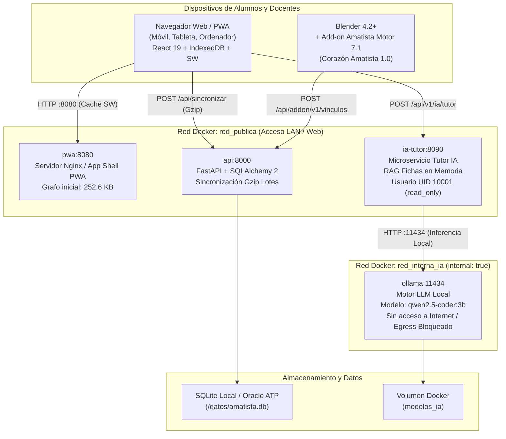

# Arquitectura del Sistema Amatista 💎

Este documento describe la arquitectura técnica de **Amatista**, los diagramas C4 de contenedores de microservicios, el aislamiento de redes para el motor de IA local y los registros de decisiones arquitectónicas (ADR).

---

## 1. Diagrama C4 de Contenedores y Redes

---

## 2. Microservicios y Componentes

### 2.1. Núcleo PWA (`pwa:8080`)
- **Tecnología:** React 19, Vite 8, Tailwind CSS 4, `vite-plugin-pwa`.
- **Estrategia de Caché:** `Service Worker` precachea el grafo inicial universal de **252,6 KB** (repartido en 54 archivos JS/JSON) y un índice de cursos de **5,5 KB gzip**.
- **Almacenamiento Local:** `IndexedDB` gestiona el estado del alumno, las lecciones, los puntos de experiencia (XP) y la cola transaccional *Outbox*.
- **Asistente Goliat:** Motor de reglas determinista en JavaScript puro (`frontend/src/goliat/cerebro.js`) que ofrece asistencia pedagógica inmediata con **0 ms de latencia**.

### 2.2. API Central (`api:8000`)
- **Tecnología:** FastAPI, Python 3.12, Uvicorn, SQLAlchemy 2.
- **Base de Datos:** Oracle Autonomous Database 23ai en producción (`ADMIN`); SQLite en desarrollo local, Docker y entornos de prueba.
- **Sincronización Transaccional:** Endpoint `POST /api/sincronizar` con compresión `gzip` bidireccional. Recibe lotes de progreso deduplicados y fusionados desde el cliente.

### 2.3. Microservicio IA Tutor (`ia-tutor:8090`)
- **Tecnología:** FastAPI, Python 3.11-slim, Pydantic 2.
- **Seguridad del Contenedor:**
  - Usuario sin privilegios: `amatista:amatista` (UID `10001`).
  - Sistema de archivos de solo lectura: `read_only: true`.
  - Prevención de escalada: `security_opt: ["no-new-privileges:true"]`.
- **RAG Local (Retrieval-Augmented Generation):** Indexa en memoria las 26 fichas oficiales de herramientas de Blender (`practices/blender/fichas.json`). Recupera contexto relevante y diagnostica errores geométricos en **< 5 ms**.

### 2.4. Motor LLM Local Confinado (`ollama:11434`)
- **Imagen:** `ollama/ollama:latest`.
- **Modelo Predeterminado:** `qwen2.5-coder:3b` (3 mil millones de parámetros, alta eficiencia en razonamiento de código y atajos de modelado 3D).
- **Aislamiento de Red:** Conectado exclusivamente a la red Docker `red_interna_ia` con la directiva `internal: true`. **No tiene pasarela hacia Internet**, lo que garantiza que ninguna consulta de los alumnos ni datos del aula puedan fugarse a servidores externos.

---

## 3. Registros de Decisiones Arquitectónicas (ADR)

### ADR-001: Patrón Outbox Transaccional en IndexedDB para Sincronización Offline-First
- **Estado:** Aceptado e Implementado.
- **Contexto:** En escuelas con conectividad 2G o sin Internet constante, cada acción individual del usuario no puede depender de una llamada HTTP remota. Además, enviar cada pequeño paso individualmente cuando la red regresa saturaría el ancho de banda móvil.
- **Decisión:** Implementar el patrón *Transactional Outbox* en el cliente (`frontend/src/nucleo/colaSincronizacion.js`). Toda modificación se persiste inmediatamente en `IndexedDB`. Las modificaciones sucesivas sobre un mismo objeto (p. ej. avanzar varios pasos en una lección) se compactan y deduplican en un único registro. Al detectar conectividad con `lib/red.js`, se despacha un único lote comprimido con `Content-Encoding: gzip` a `POST /api/sincronizar`.
- **Consecuencias:**
  - *Positivas:* Ahorro de entre un 80 % y un 90 % en consumo de datos móviles; cero pérdida de progreso ante caídas de red; interfaz 100 % interactiva e instantánea.
  - *Mitigaciones:* En caso de conflicto de versiones entre múltiples dispositivos, prevalece la marca temporal más reciente con resolución determinista en el servidor.

---

### ADR-002: RAG Local y Aislamiento de Ollama en Red Docker Interna (`red_interna_ia`)
- **Estado:** Aceptado e Implementado.
- **Contexto:** Para cumplir los requisitos de Hack4Edu y garantizar el aprendizaje en centros sin conexión o con restricciones de privacidad infantil, no se pueden emplear APIs de IA en la nube como OpenAI GPT o Google Gemini en el servidor del aula.
- **Decisión:** Levantar un contenedor local de Ollama en el servidor escolar orquestado vía Docker Compose, conectado únicamente a la red `red_interna_ia` (`internal: true`). El microservicio `ia-tutor` actúa como proxy seguro realizando RAG en memoria con las 26 fichas técnicas de Blender antes de consultar al LLM.
- **Consecuencias:**
  - *Positivas:* Soberanía tecnológica total; coste de inferencia cero; estricto cumplimiento del GDPR y normativas de privacidad estudiantil al no emitir tráfico WAN.
  - *Mitigaciones:* Requiere un servidor escolar con al menos 4 núcleos y 8 GB de RAM para ejecutar el modelo `qwen2.5-coder:3b` con fluidez.

---

### ADR-003: Circuit Breaker de 1500 ms con Fallback de Latencia Cero (0 ms) a Goliat
- **Estado:** Aceptado e Implementado.
- **Contexto:** Si el servidor local de IA está apagado, sobrecargado o el estudiante utiliza la aplicación fuera del centro educativo, la interfaz de usuario no debe quedar bloqueada esperando respuestas de red.
- **Decisión:** Implementar un patrón *Circuit Breaker* en el cliente (`frontend/src/nucleo/iaLocal.js`) con un umbral de tiempo estricto de 1500 ms y conteo de fallos consecutivos. Al dispararse, el sistema conmuta instantáneamente al asistente local **Goliat** (`frontend/src/goliat/cerebro.js`), resolviendo la duda mediante heurísticas de atajos y diagnóstico rápido en 0 ms.
- **Consecuencias:**
  - *Positivas:* Disponibilidad del 100 % de la asistencia educativa; cero congelamientos de la interfaz del usuario; degradación elegante y transparente.
  - *Mitigaciones:* Goliat proporciona respuestas deterministas y concisas basadas en reglas predefinidas en lugar de explicaciones generativas en lenguaje natural extendido.
