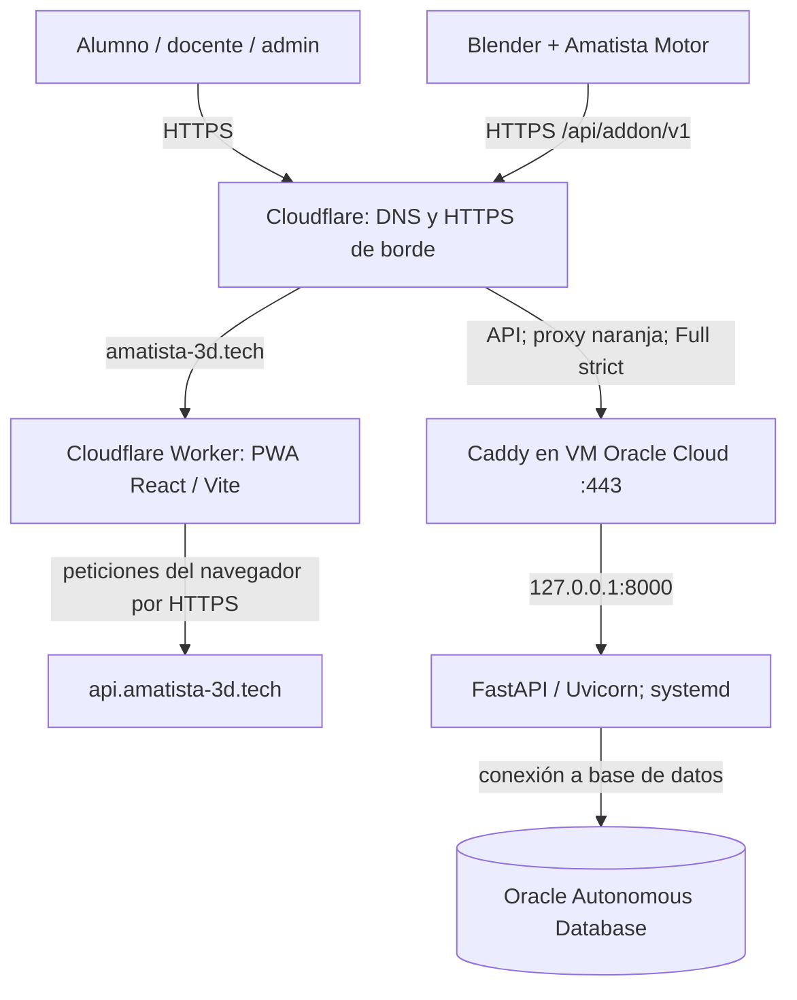

# Despliegue público de Amatista en amatista-3d.tech

**Documentado:** 29 de octubre de 2026. **Evidencia operativa:** terminal de la VM y panel de Cloudflare compartidos durante los días 22–23 de octubre de 2026. Este registro describe una instalación realizada; no garantiza que la infraestructura mantenga el mismo estado después de esas comprobaciones.

- **PWA pública:** https://amatista-3d.tech
- **API pública:** https://api.amatista-3d.tech
- **Estado API:** https://api.amatista-3d.tech/api/salud
- **Estado del add-on:** https://api.amatista-3d.tech/api/addon/v1/estado
- **Repositorio:** https://github.com/Maximiliano-cabello-mata/amatista

> **Importante:** el antiguo dominio `amatista-3d.me`, Cloudflare Pages y GitHub Pages aparecen en documentos *históricos* del repositorio; **no** son el dominio ni el alojamiento vigentes de esta instalación. El despliegue vigente usa **Cloudflare Workers con assets estáticos**. No reescribir la historia: usar este documento para operación actual.

## 1. Arquitectura efectivamente publicada



La PWA contiene caché y funcionalidad local; el servidor almacena cuentas, sesiones, progreso y catálogo. El add-on obtiene sus URL de descarga y el índice de extensiones desde la API.

## 2. Publicación del frontend: Workers Builds

Proyecto Cloudflare Workers conectado a GitHub:

| Parámetro | Valor utilizado |
|---|---|
| Repositorio | `Maximiliano-cabello-mata/amatista` |
| Rama | `main` |
| Directorio raíz | `/` |
| Comando de build | `cd frontend && npm ci && npm run build` |
| Comando de despliegue | `npx wrangler deploy --assets ./frontend/dist --compatibility-date 2026-10-19` |
| Variable de compilación | `VITE_API_URL=https://api.amatista-3d.tech` |
| Dominio personalizado | `amatista-3d.tech` |
| Subdominio de Worker observado | `amatista.233242024.workers.dev` |

La compilación reportó creación de PWA (precache de 76 recursos) y publicación satisfactoria. **`VITE_API_URL` es una variable de compilación**, por lo que cambiarla exige recompilar/republicar el frontend. No debe incluir credenciales.

`www.amatista-3d.tech` todavía mostraba advertencia de DNS ausente en Cloudflare en la sesión. No afirmar que la variante `www` o una redirección funcionan hasta comprobarlo.

## 3. DNS y TLS de la API

1. Se sustituyó el dominio original por `amatista-3d.tech` y se activó la zona DNS en Cloudflare con sus nameservers.
2. Se creó el registro **A `api` → `158.101.118.222`**, con **Proxy status: Proxied (nube naranja)**. Esta dirección es la IP pública de la VM, no una credencial.
3. En **Cloudflare → SSL/TLS**, se seleccionó **Full (strict)**.
4. Se emitió un **certificado Cloudflare Origin CA** para el origen y se instaló en Caddy como:
   - `/etc/caddy/certs/origen.pem`
   - `/etc/caddy/certs/origen.key`
5. Se configuraron permisos restrictivos para la llave: propietario/grupo `root:caddy` y modo `0640`. No almacenar jamás el contenido de los certificados privados, claves, contraseñas de Oracle o secretos SMTP en Git.

**Origen CA no es un certificado para conectar directamente desde un navegador**: se utiliza cuando Cloudflare proxy valida TLS frente a Caddy. Mantener la nube naranja y Full (strict), o cambiar el método de certificados antes de quitar Cloudflare.

## 4. VM, systemd, firewall y Caddy

Entorno observado: Oracle Linux 9 ARM64, usuario `opc`, backend en `/home/opc/amatista/backend`, venv `backend/venv`.

Servicio `amatista-backend.service` habilitado y activo:

```text
/home/opc/amatista/backend/venv/bin/uvicorn main:app --host 127.0.0.1 --port 8000
```

Esto aísla Uvicorn de las interfaces externas: el único acceso normal a la API debe pasar por Caddy en `443/tcp`. En la zona pública de `firewalld` se observaron `ssh` y `443/tcp`, sin `8000/tcp`. **Debe auditarse aparte la Security List de la VCN OCI**: existió una regla `8000/tcp` pública; no quedó una confirmación inequívoca de que se eliminara, aunque el backend ya escucha solamente en loopback.

El Caddyfile operativo se alojó en `/etc/caddy/Caddyfile` con:

- host `api.amatista-3d.tech` y `tls /etc/caddy/certs/origen.pem /etc/caddy/certs/origen.key`;
- `encode zstd gzip` y `reverse_proxy 127.0.0.1:8000`;
- filtro `remote_ip` para permitir conexiones desde rangos de Cloudflare y devolver `403` a otras conexiones;
- para solicitudes desde Cloudflare, `X-Forwarded-For` configurado a partir de `CF-Connecting-IP`.

**No copiar una lista antigua de rangos a ciegas:** verificar https://www.cloudflare.com/ips/ y mantener actualizadas las redes IPv4/IPv6. No confiar en `CF-Connecting-IP` si la conexión no llega desde un proxy Cloudflare verificado. En el código del backend (`api/limites.py`), `AMATISTA_PROXY_CONFIABLE=1` utiliza la última IP de `X-Forwarded-For`: la cadena de confianza entre Cloudflare, Caddy y FastAPI requiere **una prueba de suplantación de encabezados** antes de dar por cerrado el endurecimiento.

El archivo versionado `despliegue/Caddyfile` es una **plantilla**, no prueba del contenido exacto instalado en la VM: verificar diferencias antes de reemplazar el archivo operativo.

Validación ejecutada:

```bash
sudo caddy validate --config /etc/caddy/Caddyfile --adapter caddyfile
sudo systemctl reload caddy
sudo systemctl restart amatista-backend.service
sudo systemctl status amatista-backend.service --no-pager
curl -sS https://api.amatista-3d.tech/api/salud
```

El validador devolvió `Valid configuration`, el reload no mostró errores, Uvicorn arrancó en loopback y la API respondió `{"estado":"ok","motor":"oracle"}`. Los avisos de formato y OCSP sobre Origin CA no impidieron la validación.

## 5. Variables de entorno del backend

El código usa `python-dotenv` (`database/conexion.py` llama a `load_dotenv()`). En la instalación se editó `/home/opc/amatista/backend/.env`, conservando las credenciales que ya tenía, y se hizo una copia `.env.bak`.

**Valores no secretos documentados**, para configurar en el entorno de producción:

```dotenv
AMATISTA_URL_API=https://api.amatista-3d.tech
AMATISTA_URL_PWA=https://amatista-3d.tech
CORS_ORIGINS=https://amatista-3d.tech,https://www.amatista-3d.tech
AMATISTA_PROXY_CONFIABLE=1
AMATISTA_MOSTRAR_CODIGOS=0
AMATISTA_SIN_LIMITES=0
AMATISTA_OCULTAR_DOCS=1
```

```bash
cd /home/opc/amatista/backend
chmod 600 .env .env.bak
sudo systemctl restart amatista-backend.service
```

No subir `.env`, `.env.bak`, `origen.key`, volcados SQL con cuentas ni tokens. `AMATISTA_PROXY_CONFIABLE=1` solo es seguro si el backend no es accesible directamente y el proxy sanea la cabecera. Verificar que no haya claves privadas duplicadas en carpetas temporales de la VM; borrar copias temporales únicamente tras confirmar el origen instalado.

## 6. Pruebas funcionales observadas el 23 de octubre

### Salud y motor

```bash
curl -sS https://api.amatista-3d.tech/api/salud
curl -sS https://api.amatista-3d.tech/api/addon/v1/estado
```

Resultados registrados:

- Salud: HTTP correcto y `{"estado":"ok","motor":"oracle"}`.
- Add-on: `Amatista Motor 5.3`, `version_addon=5.3.0`, `version_motor=5.0.0`, Blender mínimo `4.2.0`.
- Los enlaces de descarga Windows/macOS/Linux y el índice de extensiones ya se publican con `https://api.amatista-3d.tech`, no `127.0.0.1`.
- **No se verificó descargar e instalar cada paquete desde esos enlaces**. La prueba de Blender con ventana T-113 sigue siendo independiente.

### CORS desde la PWA

```bash
curl -s -D - -o /dev/null \
  -H "Origin: https://amatista-3d.tech" \
  https://api.amatista-3d.tech/api/salud

curl -s -D - -o /dev/null -X OPTIONS \
  -H "Origin: https://amatista-3d.tech" \
  -H "Access-Control-Request-Method: POST" \
  -H "Access-Control-Request-Headers: authorization,content-type" \
  https://api.amatista-3d.tech/api/salud
```

Ambas peticiones devolvieron HTTP/2 `200`, `access-control-allow-origin: https://amatista-3d.tech` y la OPTIONS permitió `POST`, `Authorization` y `Content-Type`. El propietario confirmó manualmente que podía utilizar la web/iniciar sesión; esto **no equivale a una prueba sistemática con alumnos ni confirma todos los flujos de autenticación**.

### Lectura de Oracle: fotografía, no métricas en vivo

Consulta `SELECT COUNT(*)` mediante `database.conexion.motor()` y SQLAlchemy:

| Tabla | Filas observadas |
|---|---:|
| `USUARIOS` | 8 |
| `SESIONES` | 10 |
| `EVENTOS_APRENDIZAJE` | 269 |
| `PROGRESO_LECCIONES` | 28 |
| `PROGRESO_PRACTICAS` | 14 |

Por `USUARIOS.CREADO_EN`, aparecieron **2 cuentas el 23 de octubre de 2026**, ambas con `ES_PRUEBA=0` y `CORREO_CONFIRMADO=0`. No puede atribuirse su identidad a alumnos externos: la marca `ES_PRUEBA` depende de cómo fueron creadas las cuentas. `SESIONES` y `EVENTOS_APRENDIZAJE` son filas acumuladas, **no** usuarios activos únicos ni sesiones concurrentes.

Cloudflare mostró aproximadamente 162 visitas y agentes automatizados como `CoinCreatorScanner`, `facebookexternalhit`, `python-httpx` y `HeadlessChrome`. Las visitas o solicitudes **no** permiten inferir 162 personas reales. Se observó una tasa 5xx del 0.40 % en el panel (sin diagnóstico de rutas/causas).

## 7. Correo electrónico y acceso público: pendientes

`backend/api/correo.py` implementa SMTP pero **no se configuró proveedor SMTP ni se verificó ningún envío real**. Se evaluaron Brevo y Cloudflare Email Sending, pero **no se contrató ni activó** una solución. Cloudflare avisó que `@amatista-3d.tech` no tiene MX para recepción y que los registros de autenticación de correo están incompletos.

- No habilitar `AMATISTA_REQUIERE_CONFIRMACION=1` hasta verificar el flujo completo de envío/recepción/confirmación.
- `AMATISTA_MOSTRAR_CODIGOS=0` debe permanecer desactivado en producción; no publicar códigos por consola o respuesta HTTP.
- Si el correo es requisito de seguridad o de incorporación, **no abrir registro masivo sin una alternativa validada**, soporte de recuperación de acceso y revisión de permisos.
- Cloudflare Email Routing solo reenvía correo **entrante**; no sustituye el servicio de envío SMTP del backend.
- `www.amatista-3d.tech` sigue pendiente de DNS/redirección cuando se quiera admitir esa URL.
- Revisar controles de acceso, encabezados confiables, bots, 5xx, pruebas reales del add-on y monitoreo antes de una convocatoria amplia.

## 8. Operación, diagnóstico y reversión

**Después de cambios de backend:**

```bash
cd /home/opc/amatista/backend
python diagnostico_oracle.py
sudo systemctl restart amatista-backend.service
sudo systemctl status amatista-backend.service --no-pager
sudo journalctl -u amatista-backend.service -n 50 --no-pager
curl -fsS https://api.amatista-3d.tech/api/salud
```

No ejecutar migraciones sin respaldo; seguir `backend/sql/LEEME.txt` y **nunca ejecutar 001** sobre una base con datos.

**Después de cambios de Caddy:** guardar una copia previa, validar antes de recargar y comprobar el endpoint público. Si la modificación falla, restaurar la última copia **segura y funcional**, validar y recargar. No restaurar indefinidamente una plantilla histórica sin las protecciones actuales.

```bash
sudo caddy validate --config /etc/caddy/Caddyfile --adapter caddyfile
sudo systemctl reload caddy
curl -fsS https://api.amatista-3d.tech/api/salud
```

**Para el frontend:** el historial de Cloudflare Workers permite ubicar despliegues anteriores. Comprobar conexión desde el navegador en el dominio oficial, no asumir que pasar `npm run build` equivale a probar Oracle.

**Próximas comprobaciones prioritarias:** 1) configuración y resistencia a suplantación de IP reales detrás de Cloudflare; 2) inexistencia de acceso público al 8000 en OCI; 3) instalación de descargas Blender; 4) pruebas con alumno nuevo y recuperación de cuenta; 5) análisis de errores 5xx; 6) controles de correo; 7) actualizar documentos operativos y tareas, sin reescribir bitácoras históricas.

## 9. Relación con documentos anteriores

- [Plan original del dominio .me (histórico)](2026-10-04_dominio_amatista-3d.md): documenta una intención anterior (Pages, antiguo dominio), **no** el despliegue vigente.
- [Guía OCI inicial](2026-10-04_despliegue_oci.md): antecedentes de infraestructura.
- [Prerrequisitos de Motor 5.2/SQL 012](2026-10-11_auditoria_y_motor_5_2.md): guía del estado del código del 18 de octubre; cotejar con los endpoints antes de reutilizar versiones.
- [README principal](../../README.md) e [índice de documentación](../README.md): referencias actuales de acceso y operación.

**Alcance de esta actualización:** documentación y alineación de configuración versionada. No modifica por sí sola los servicios ya instalados ni verifica el estado actual del DNS/Oracle en fecha posterior a las evidencias indicadas.
