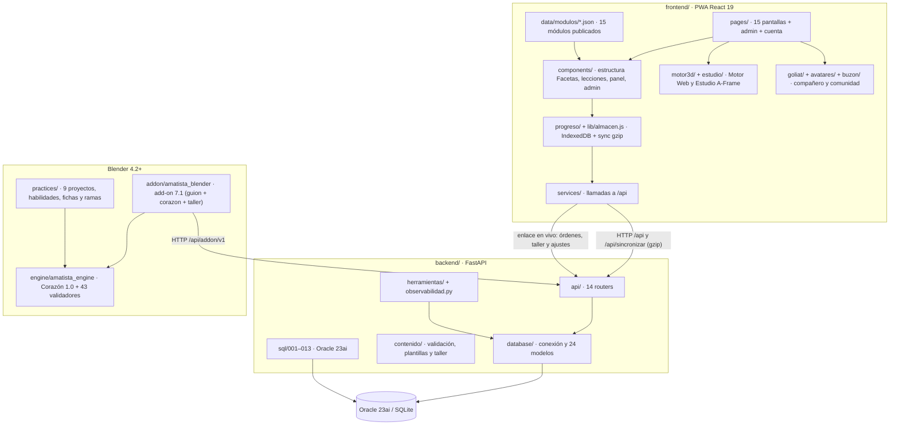

# Mapa del repositorio

Dónde está cada pieza de Amatista, cómo se conectan y por dónde empezar a leer. Para cualquiera que abre el repositorio por primera vez.

Actualizado: 2 de noviembre de 2026 (`main` en `99d6ea2`; Amatista Motor 7.1 · Corazón Amatista 1.0 · SQL 013).

## 1. Las piezas en una imagen

## 2. Carpetas de la raíz

| Carpeta / archivo | Qué es | Tamaño aprox. | Manual |
|---|---|---|---|
| `frontend/` | PWA React 19 + Vite 8 + Tailwind 4 + A-Frame 1.8. Incluye cursos, Estudio A-Frame, Motor Web 3D, Goliat, avatares, buzón y Admin | 310 archivos en `src/`, ~50 200 líneas | [02 Frontend](02_frontend.md) |
| `backend/` | API FastAPI (14 routers), 24 modelos SQLAlchemy, scripts de Oracle `001`–`013`, CLI de contenido, Sentry opcional y pruebas | 82 archivos, ~22 800 líneas | [03 Backend](03_backend.md) |
| `engine/` | Amatista Engine en Python puro: **Corazón Amatista 1.0** (`corazon/`), **Guion** (`guion/`), **Taller** (`taller/`), 43 validadores, reconocimiento de figuras y siluetas | 129 archivos, ~21 100 líneas | [04 Motor](04_motor_addon_y_practicas.md) |
| `addon/` | Extensión «Amatista Motor» 7.1.0 para Blender 4.2+, adaptador del Corazón, banda de guion, plantilla «Blender Amatista», constructor `.zip` e instaladores `.exe`/`.deb` | 101 archivos, ~24 700 líneas | [04 Motor](04_motor_addon_y_practicas.md) |
| `practices/` | 9 prácticas de proyecto en `blender/<curso>/m<n>-<nombre>/`, catálogo de 33 habilidades (`habilidades.json`), 26 fichas (`fichas.json`), `temas.json`, `ramas/` del Corazón y `archivo/` | 9 proyectos + 33 habilidades + 3 ramas | [04 Motor](04_motor_addon_y_practicas.md) |
| `tablero/` | Generador del Kanban (`actualizar.py`), tareas (`tareas.yml`), pruebas e histórico de la v2 | 6 archivos | [Manual del desarrollador](../desarrollador/05_flujo_de_trabajo.md) |
| `despliegue/` | Unidad systemd (`amatista-api.service`), `Caddyfile` (HTTPS) y `actualizar.sh` para la VM | 3 archivos | [Despliegue público](../despliegue/2026-10-29_despliegue_publico_amatista_3d_tech.md) |
| `herramientas/` | `crear-tags.sh` (tags de versión hasta `v3.0.0-alpha.15`) | 1 archivo | [Manual del desarrollador](../desarrollador/02_herramientas_de_linea_de_comandos.md) |
| `ai_tutor/` | `prompts/` reservado para el tutor IA | — | — |
| `docs/` | Toda la documentación organizada en 10 secciones | 214 archivos | [Índice](../README.md) |
| `wrangler.jsonc` | Configuración de compilación y despliegue de la PWA en Cloudflare Workers | 1 archivo | [Workers Builds](../despliegue/2026-10-29_cloudflare_workers_builds.md) |
| `README.md` | Presentación general del proyecto | | |
| `PROYECTO.md` | Centro de dirección: prioridades, frentes y reglas de trabajo | | |
| `KANBAN.md` | Tablero generado automáticamente (no se edita a mano) | | |
| `CHANGELOG.md` | Historial completo de entregas | | |

## 3. Puntos de entrada

| Para entender… | Abre primero | Luego |
|---|---|---|
| La PWA | `frontend/src/main.jsx` → `frontend/src/App.jsx` | `rutas.js`, `pages/`, `components/estructura/` |
| Un módulo de contenido | `frontend/src/data/modulos/blender_principiante-modulo-1.json` | `backend/contenido/validacion.py`, `frontend/src/data/herramientas.js` |
| El Motor Web y el Estudio A-Frame | `frontend/src/motor3d/` y `frontend/src/pages/Estudio.jsx` | `frontend/src/estudio/` |
| Goliat, avatares y buzón | `frontend/src/goliat/Goliat.jsx` | `frontend/src/avatares/`, `frontend/src/pages/Buzon.jsx` |
| La API | `backend/main.py` (registra middlewares y los 14 routers) | `backend/api/dependencias.py`, cada `backend/api/*.py` |
| Los datos | `backend/database/modelos.py` (24 tablas) | `backend/sql/LEEME.txt`, `backend/diagnostico_oracle.py` y [esquema](../base-de-datos/esquema.md) |
| El Corazón y el motor | `engine/amatista_engine/corazon/` y `engine/amatista_engine/engine.py` | `guion/`, `taller/`, `practice/`, `validators/`, `ejemplo/`, `figures/` |
| El add-on de Blender | `addon/amatista_blender/__init__.py` | `corazon/adaptador.py`, `guion/`, `taller/`, `fichas.py`, `enlace.py`, `protocolo.py`, `saneamiento.py` |
| Una práctica o rama | `practices/blender/principiante/m1-tren/practica.json` y `practices/ramas/blender-principiante.json` | `practices/blender/habilidades.json`, `practices/blender/fichas.json` |

## 4. Routers de la API

Registrados en `backend/main.py` en este orden:

| Archivo | Para qué |
|---|---|
| `api/auth.py` | Cuentas: registro, inicio de sesión, confirmación de correo, recuperación y cambio de contraseña |
| `api/sesiones.py` | `/api/iniciar-sesion` heredado de la v1 (alumnos anónimos) |
| `api/progreso.py` | Guardar y leer el progreso (`?desde=` incremental); fusión del progreso offline (`api/fusion.py`) |
| `api/eventos.py` | Eventos de aprendizaje deduplicados y métricas |
| `api/sincronizar.py` | `POST /api/sincronizar`: lote de progreso y eventos en una sola petición comprimida con gzip (escuelas con pocos datos) |
| `api/admin.py` | Panel de administración: resumen, usuarios, auditoría, métricas y mantenimiento |
| `api/contenido.py` | Catálogo con ETag, módulos, lecciones, plantillas, publicar y archivar |
| `api/niveles.py` | Niveles y mapa del curso (v3) |
| `api/blender.py` | Versiones de Blender y matriz de compatibilidad |
| `api/addon.py` | API del add-on `/api/addon/v1`: vínculo por código, prácticas, intentos, descargas (`.exe`, `.deb`, `.zip`) |
| `api/enlace.py` | Enlace en vivo plataforma ↔ Blender: latido (`detalle`), cola de órdenes (`leccion`, `recorrido`, `abrir_practica`, `taller`, etc.) y ajustes (`sql/010` y `sql/011`) |
| `api/taller.py` | Amatista Taller (`/api/addon/v1/habilidades`, `/talleres`): modelo BKT del alumno por habilidad e isla (`sql/012`) |
| `api/perfil.py` | Avatares low poly por cuenta (`GET/PUT /api/perfil/avatar`, `sql/013`) |
| `api/buzon.py` | Buzón del creador (`/api/buzon` para alumnos y `/api/admin/buzon` para responder y resolver, `sql/013`) |

Apoyo: `api/comun.py`, `api/dependencias.py`, `api/limites.py` (límites por IP y cuenta), `api/correo.py` (SMTP) y `observabilidad.py` (Sentry opcional).

## 5. Pantallas de la PWA

| Página | Archivo | Quién |
|---|---|---|
| Cursos (camino guiado por programa) | `pages/Inicio.jsx` | todos |
| Mapa del curso e isla | `pages/Curso.jsx` | alumno |
| Lección interactiva | `pages/Leccion.jsx` | alumno |
| Estudio A-Frame (`#/estudio`) | `pages/Estudio.jsx` + `estudio/` + `motor3d/` | todos (funciona offline) |
| Mi panel (con modo Ahorro de datos) | `pages/Panel.jsx` | alumno |
| Página Blender y vinculación | `pages/Blender.jsx`, `pages/Vincular.jsx` | alumno |
| Ayuda y recorrido guiado (`#/guia`) | `pages/Guia.jsx` + `recorrido/` | todos |
| Buzón del creador (`#/buzon`) | `pages/Buzon.jsx` + `buzon/` | alumno con cuenta |
| Cuenta y perfil con avatar (`#/perfil`) | `pages/cuenta/*` (`Entrar`, `Registro`, `Confirmar`, `Recuperar`, `Perfil`) | todos |
| Compañero Goliat (flotante) | `goliat/Goliat.jsx` | todos |
| Admin (`#/admin/*`) | `pages/admin/*` (`Admin`, `Resumen`, `Contenido`, `EditorLeccion`, `Practicas`, `Herramientas`, `Usuarios`, `Usuario`, `Auditoria`, `Revision`, `Buzon`, `Sistema`) | profesor (lectura) y admin |
| Diagnóstico técnico (`#/laboratorio`) | `pages/Laboratorio.jsx` | profesor y admin |

## 6. Motor y add-on

| Paquete | Para qué |
|---|---|
| `engine/amatista_engine/corazon/` | **Corazón Amatista 1.0** (`amatista.corazon/1`): `director.py`, `andamio.py`, `senales.py`, `perfiles/` (Blender y A-Frame, software libre), `extensiones.py`, `ramas.py` y `conformidad.py` |
| `engine/amatista_engine/guion/` | **Motor 7 «Guion»**: convierte objetivos en pasos con verbo evaluados por el resultado en escena, en cualquier orden y con pistas de ubicación real |
| `engine/amatista_engine/taller/` | **Motor 5 «Amatista Taller»**: catálogo de habilidades (`amatista.skill/1`), modelo BKT con olvido, molde pieza por pieza y cajas de repaso |
| `engine/amatista_engine/validators/` | Los 43 validadores: escena, objetos, mallas, transformaciones, materiales, animación, figura (`figure.recognize`, `figure.silhouette`), `example.matches` y `taller.molde` |
| `engine/amatista_engine/ejemplo/` | Ejemplo resuelto por práctica (`pasos.py`) y comparación aspecto por aspecto (`revision.py`) |
| `engine/amatista_engine/figures/` | Reconocimiento geométrico de piezas (`reconocer.py`) y corte de silueta en una sola malla (`silueta.py`) |
| `addon/amatista_blender/corazon/` | Adaptador de Blender para el Corazón (`adaptador.py`): ejecuta señales reales en la UI y las comprueba cada 0,5 s |
| `addon/amatista_blender/guion/` | Banda superior en la vista 3D (`banda.py`), panel `N › Amatista › Paso a paso` (`panel.py`) y señalización verificada (`senalar.py`) |
| `addon/amatista_blender/taller/` | Sesión del taller, molde 3D, demostraciones «Mira», acompañamiento por ánimo (`acompanar.py`) e isla del alumno (`isla.py`) |
| `addon/amatista_blender/` (raíz) | `fichas.py` (fichas y modo curioso), `plataforma.py` (lección en vivo), `blender_amatista.py` (plantilla de app), `integracion.py` y `protocolo.py` (`amatista://`), `saneamiento.py` (autosanación), `navegar.py` («Volver a mi práctica») |

## 7. Convenciones del código

- **Idioma**: nombres y comentarios en español en la plataforma, en el Corazón, en el Guion y en el Taller; la primera capa del motor conserva nombres en inglés (`engine.py`, `validators/`) por compatibilidad con el esquema original.
- **Local primero**: nada de lo que el alumno ya descargó depende del servidor.
- **Migraciones aditivas**: un cambio de esquema es un script nuevo `014_*.sql` idempotente; nunca se edita uno ya ejecutado en producción.
- **Comentarios con enlace a su documento**: muchos archivos citan `docs/...` en su encabezado; si mueves un documento, actualiza esas rutas.
- **Sin secretos en el repo**: solo archivos `.env.example`.
