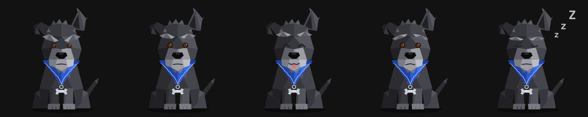
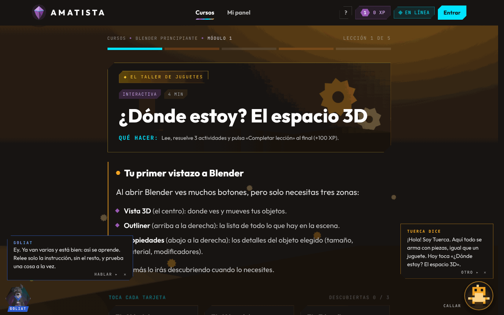
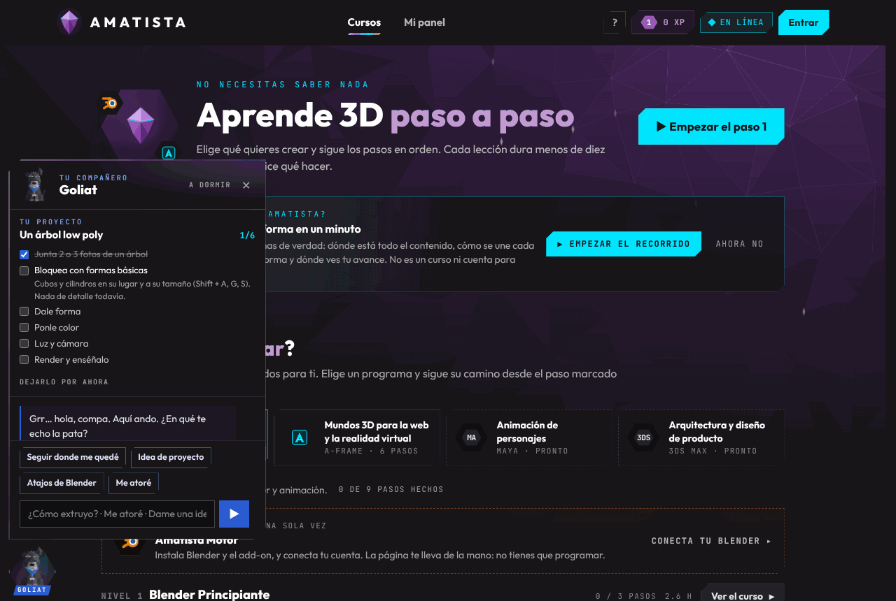

# Goliat, el compañero de Amatista (30 de octubre de 2026)

Pedido del creador: «Goliat. Este es un gusto personal. Vamos a agregar un asistente […] un perrito de la vida real. Se llama Goliat. Es un perrito muy gruñón […] Quiero que lo hagas como un personaje low poly […] que te ayude en funciones básicas […] que te incentive a generar proyectos […] que sea algo que quede inmortalizado […] que sea un asistente y que sea un fiel amigo […] y que te ayude a que no te frustres dentro de las prácticas.» La IA debía funcionar local o por procesos, sin servicios externos. Tarea T-146.

## 1. El personaje

Goliat es el perro de Maximiliano. El dibujo sale de 14 fotos y conserva lo que lo hace reconocible:

| Rasgo en las fotos | En el low poly |
|---|---|
| Pelo negro rizado con canas, más gris en patas y panza | Facetas en cinco tonos de gris carbón y mechones canosos en copete, pecho y manos. |
| Una oreja parada y en punta, la otra doblada | La derecha alta y despeinada; la izquierda cae hacia delante. |
| Cejas pobladas y barba de schnauzer, el hocico canoso | Cejas grises en tres facetas; hocico y barba en los grises más claros. |
| Ojos cafés con brillo y cara de pocos amigos | Ojos cafés hexagonales; cejas que bajan hacia el centro y boca plana. |
| Pañoleta azul con orilla cosida en zigzag | Triángulo azul en tres tonos con la costura clara. |
| Placa plateada en forma de hueso | Hueso de plata en su argolla. |

La luz viene de arriba a la derecha, como en los encabezados Facetas. Es un SVG de unas 90 caras (`frontend/src/goliat/GoliatFigura.jsx`), sin imágenes ni librerías.

**Cinco gestos**, solo cambian cejas, ojos, orejas, boca y cola: **gruñón** (el de siempre), **atento** (inclina la cabeza y levanta la oreja doblada), **contento** (ojos cerrados de gusto, lengua y cola que se mueve), **preocupado** (cejas hacia arriba, cuando te ve atorado) y **echado** (dormido, como en la foto de la almohada). Parpadea y mueve la oreja parada cada tanto. Todo se apaga en modo ligero, con movimiento reducido y al imprimir.

## 2. Dónde vive

- **En todas las páginas, abajo a la izquierda**, sentado sobre un hexágono facetado con su nombre en una cinta azul. La derecha es de la mascota del módulo en las lecciones: no se estorban. Se carga después de la página (`lazy`), así que no retrasa la portada.
- **Callado por defecto.** No platica solo ni cuenta datos curiosos. Sale con un globo en tres casos: la primera vez que lo conoces (una sola vez), cuando una práctica se pone difícil y cuando sale algo que costó.
- **Ayuda › «Conoce a Goliat»**: su retrato grande, quién es, qué hace, sus cinco caras y «Hablar con Goliat».
- Se esconde durante el recorrido guiado.

## 3. Qué hace

Al tocarlo se abre su panel: botones rápidos, una caja para escribirle y, si tienes uno, tu proyecto.

| Le pides | Responde |
|---|---|
| «Seguir donde me quedé» | La lección pendiente más reciente, con el botón para abrirla. Sin nada pendiente, invita a un proyecto propio. |
| «Idea de proyecto» | Una idea a tu medida según las lecciones que llevas (empezando: taza, árbol, hongo, tu mesa; ya modelas: tu cuarto en isométrico, un cofre, una farola, un robot; avanzado: tu mascota, una isla flotante animada, una esquina de tu colonia). «Otra idea» rota. «Lo hago» la vuelve **tu proyecto**: seis pasos (referencia, bloqueo, forma, color, luz y cámara, render) que marcas al terminar; el paso que sigue muestra su pista. Se guarda en el equipo. |
| «¿Cómo extruyo?», «girar», «no veo el objeto» | El atajo de Blender (22 en la lista) con un consejo. Entiende faltas: «estruyo» encuentra Extruir. |
| «Me atoré», «no me sale», «me rindo» | Apoyo en pasos chicos, nunca la respuesta del ejercicio. |
| Avance, insignias, conectar Blender, A-Frame, cuenta y contraseña, sin internet, va lento, exámenes, «quién eres», gracias | Respuesta corta y el botón a la página que toca. |

Si no entiende, lo dice («Grr… eso no lo olfateo todavía») y ofrece los caminos más comunes. «A dormir» lo deja echado: solo se levanta si una práctica se pone fea.

## 4. Que no te frustres

Las actividades y los exámenes le avisan con un evento del navegador (`goliat/eventos.js`), igual que a la mascota del módulo:

- `useActividad` (todas las actividades) avisa cada resultado; las seis que se comprueban varias veces (Ajusta el valor, Clasificar, Completar, Emparejar, Ordenar, Reto de código) también cada intento fallido con `fallar(n)`.
- `Examen` avisa si se aprobó.

La regla (`goliat/frustracion.js`, con pruebas): no entra al primer fallo (eso ya lo hace la mascota). Se acerca al **tercer intento fallido** de una actividad, con **dos fallos seguidos** o con **un examen sin aprobar**. Como mucho un apoyo cada 45 s. Los dos primeros apoyos cambian de táctica (relee solo la instrucción; vuelve a la explicación); el tercero sugiere una pausa de cinco minutos. Cuando por fin sale, lo celebra: «Costó y salió».

## 5. Cómo piensa (sin servicios externos)

`goliat/cerebro.js` es un asistente por reglas que corre completo en el navegador:

1. Normaliza el texto (minúsculas, sin acentos ni signos).
2. Compara cada palabra con las claves de cada intención por igualdad, por raíz («extru» cubre extruir y extrusión) o con una falta de ortografía (distancia de edición 1).
3. Gana la intención con más puntos; las claves de varias palabras («me rindo») deben ir seguidas y cada una tiene su peso.
4. Un atajo de Blender gana si la pregunta va de «cómo hago X» o es muy corta; la frustración le gana al atajo («rompí todo y me rindo» es apoyo, no Ctrl + Z).

Todo lo que sabe está en `goliat/conocimiento.js` (intenciones, atajos, ideas y pasos de proyecto). **Para enseñarle algo nuevo** basta con sumar una intención con sus claves y respuestas; las pruebas comprueban que los ids no se repitan.

Si más adelante se quiere un modelo de lenguaje local (T-012, Ollama), el panel ya está listo: bastaría con que `responder` consulte al tutor cuando la regla no entienda.

## 6. Archivos

| Archivo | Qué hace |
|---|---|
| `frontend/src/goliat/GoliatFigura.jsx` | El dibujo low poly y sus cinco gestos. |
| `frontend/src/goliat/Goliat.jsx` | El botón, el globo, el panel, el proyecto y los avisos. Se monta una vez en `App.jsx`. |
| `frontend/src/goliat/cerebro.js` · `conocimiento.js` | El asistente por reglas y lo que sabe (pruebas en `cerebro.test.js`). |
| `frontend/src/goliat/frustracion.js` | Cuándo acercarse (pruebas en `frustracion.test.js`). |
| `frontend/src/goliat/eventos.js` | `avisarGoliat` (actividades y exámenes) y `abrirGoliat` (abrirlo con una pregunta). |
| `frontend/src/goliat/ConoceGoliat.jsx` | La sección de Ayuda. |
| `frontend/src/index.css` › «Goliat» | Hexágono, globo, panel, gestos vivos y su apagado en modo ligero. |

Se guarda en el equipo (`localStorage`): `amatista.goliat.conocido`, `amatista.goliat.dormido` y `amatista.goliat.proyecto`. Nada viaja al servidor. Sin SQL ni cambios en el backend.
