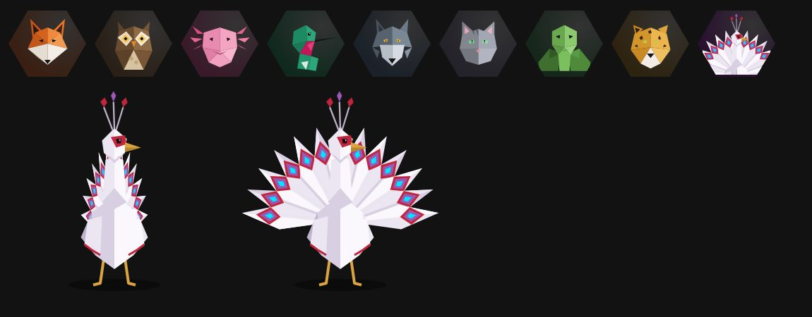
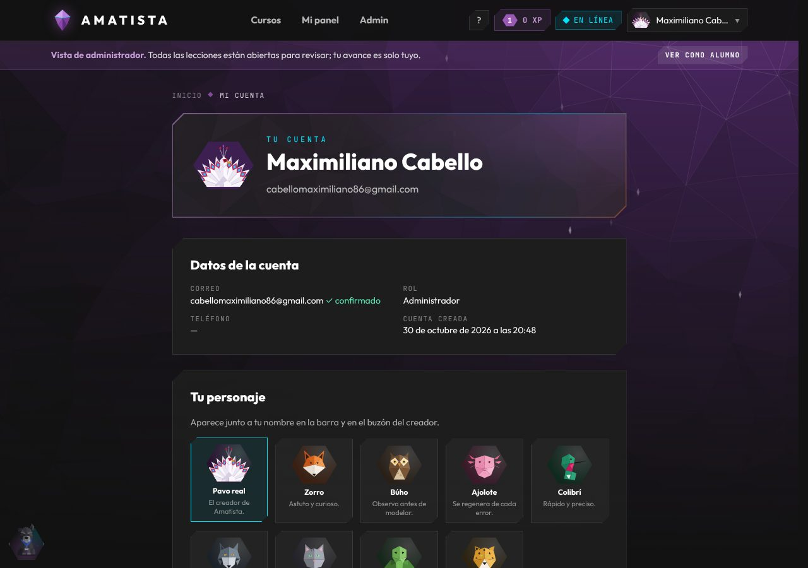
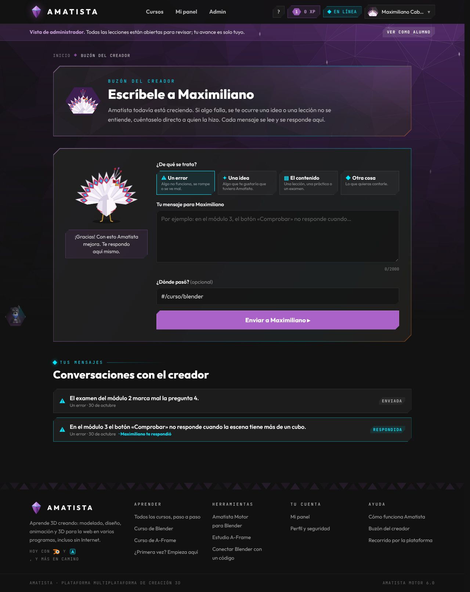
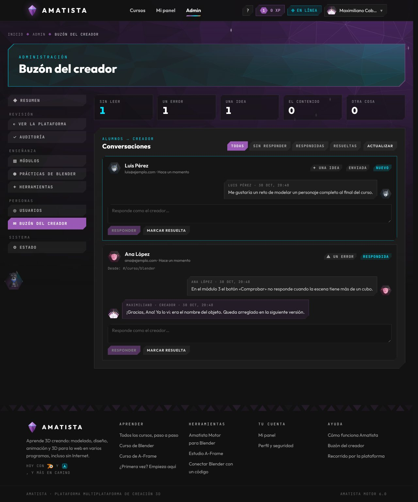

# 16 · Interfaz libre, avatares y buzón del creador (30 oct 2026)

> «Liberemos un poco la interfaz y no llenemos de notificaciones, sino que se sienta muy natural… que puedan contar con avatares… mi avatar en específico fuera un pavo real… que tú puedas mandar tus sugerencias al creador… a través de un chat directamente conmigo… y que el pavo real tenga una pequeña animación como que agradeciendo.» (Maximiliano, 30 oct 2026)

Tarea T-148 (hecha) y T-149 (aplicar en producción). Script SQL **013**.

## 1. Una interfaz más libre

Nada habla solo:

- **Goliat** ya no se presenta la primera vez ni muestra su nombre en una cinta. Queda sentado abajo a la izquierda, algo transparente (opacidad 0.8) hasta que pasas el ratón o lo enfocas, y solo se acerca cuando una práctica se pone difícil o cuando sale algo que costó (doc 15).
- **La mascota del módulo** (abajo a la derecha en las lecciones, v4.4) ya no saluda al entrar ni platica cada minuto, a la mitad o tras un rato quieto. Solo reacciona a lo que hiciste: un fallo o el final de la lección. Se puede silenciar como antes.
- **El buzón no avisa**: no hay globos, puntos ni contadores en la barra. Las respuestas del creador se ven al volver a `#/buzon` (la conversación se marca con «Maximiliano te respondió»).

## 2. Avatares low poly

Cada cuenta elige su personaje en **Perfil › Tu personaje**. Aparece en la barra (menú de la cuenta), en el encabezado del perfil y en el buzón. Si no eligió, se ve su inicial como antes.

| id | Personaje | Frase |
|---|---|---|
| `zorro` | Zorro | Astuto y curioso. |
| `buho` | Búho | Observa antes de modelar. |
| `ajolote` | Ajolote | Se regenera de cada error. |
| `colibri` | Colibrí | Rápido y preciso. |
| `lobo` | Lobo | Aprende en manada. |
| `gato` | Gato | Siempre cae de pie. |
| `tortuga` | Tortuga | Lento, pero termina. |
| `jaguar` | Jaguar | Fuerza y paciencia. |
| `pavo_real` | **Pavo real** | El creador de Amatista. **Solo la cuenta del creador.** |

Todos son originales, en el mismo low poly que Goliat (caras planas, luz arriba a la derecha). Los bustos son datos en `frontend/src/avatares/animales.js`; sumar uno es agregar sus polígonos, su entrada en `catalogo.js` y el id en `backend/api/perfil.py › AVATARES` (la prueba `test_buzon.py` comprueba que los dos catálogos coincidan).

**Dónde se guarda.** Con sesión, en el servidor (`PUT /api/perfil`, tabla `PERFILES`) y una copia en el dispositivo para pintarlo al instante y sin conexión. Sin el script 013 el servidor responde 503 y la elección se queda en el dispositivo; el perfil lo dice.

### El pavo real del creador

Un personaje **original**, no una copia de ningún personaje de película (como se decidió el 4 de octubre para las mascotas): plumaje blanco porcelana, marcas carmesí alrededor del ojo como pintura de ceremonia, pico y patas dorados, cresta de tres plumas y una cola de 13 plumas cuyos ojos llevan los colores de Amatista (carmesí, amatista y neón). Elegante y un poco teatral. Está en `frontend/src/avatares/PavoReal.jsx` con tres gestos:

- `quieto`: la cola recogida.
- `abierto`: la cola abierta en abanico (el busto del avatar).
- `gracias`: hace una reverencia y abre la cola (2.4 s). Es la animación que ve el alumno al enviar un mensaje.

Las animaciones son CSS (`index.css › Personajes`) y se apagan en modo ligero y con movimiento reducido.

**Quién es el creador.** `AMATISTA_CREADOR` en `backend/.env` (correos separados por coma). En producción: `AMATISTA_CREADOR=cabellomaximiliano86@gmail.com`. Si está vacío, cualquier administrador cuenta como creador (útil en desarrollo). Solo el creador puede elegir el pavo real (403 para los demás) y, si no eligió otro, lo tiene por defecto.

## 3. Buzón del creador

`#/buzon`: el alumno le escribe a Maximiliano sobre algo concreto.

1. Elige de qué se trata: **un error**, **una idea**, **el contenido** (lección, práctica, examen) u **otra cosa**.
2. Escribe (hasta 2000 caracteres) y, si quiere, dónde pasó (se llena solo cuando se llega con `#/buzon?desde=#/…`).
3. Al empezar a escribir el pavo real abre la cola; al enviar hace la reverencia y dice «¡Gracias! Con esto Amatista mejora. Te respondo aquí mismo.»
4. Abajo, sus conversaciones: cada una se abre, muestra el hilo (el creador con su pavo real a la izquierda) y permite añadir algo más mientras no esté resuelta.

Necesita cuenta (para poder responder); sin sesión invita a entrar. Límite: 10 mensajes por hora por cuenta, 40 mensajes por conversación.

**Dónde está, sin avisos:** el menú de la cuenta («Buzón del creador»), el pie de página (columna Ayuda), la página Ayuda («Escribirle al creador») y Goliat: si le dices «quiero reportar algo», «tengo una sugerencia» o «algo no funciona», te lleva al buzón.

### Admin › Buzón del creador

`#/admin/buzon` (grupo Personas, solo administradores): primero lo no leído, cifras por categoría, filtro por estado (sin responder, respondidas, resueltas), el hilo con el avatar del alumno y la respuesta **como el creador**. «Marcar resuelta» cierra la conversación (la página del alumno deja de ofrecer «Añade algo más») y «Reabrir» la devuelve.

## 4. Servidor

| Ruta | Quién | Qué hace |
|---|---|---|
| `GET /api/perfil` | Cuenta | `{avatar, es_creador, guardado}` |
| `PUT /api/perfil` | Cuenta | `{avatar}`; 422 si no existe, 403 si pide el pavo real sin ser el creador |
| `GET /api/buzon` | Cuenta | Sus conversaciones con mensajes |
| `POST /api/buzon` | Cuenta | Abre una: `{categoria, texto, pagina?}` |
| `POST /api/buzon/{id}/mensajes` | Dueño | Añade un mensaje y la conversación vuelve a abierta (409 pasados 40 mensajes) |
| `POST /api/buzon/{id}/leida` | Dueño | Marca leída la respuesta del creador |
| `GET /api/buzon/bandeja?estado=` | Admin | Todas, con nombre, correo y avatar del alumno, y `sin_leer` |
| `POST /api/buzon/bandeja/{id}/responder` | Admin | Responde como el creador (estado → respondida) |
| `POST /api/buzon/bandeja/{id}/estado` | Admin | `abierta`, `respondida` o `resuelta` |

Sin el script 013 todas responden 503 (o vacío) y el resto de la plataforma sigue igual. Código: `backend/api/perfil.py`, `backend/api/buzon.py`; pruebas: `backend/tests/test_buzon.py`.

### Script 013 (`backend/sql/013_avatares_y_buzon.sql`)

- `PERFILES(USUARIO_ID PK → USUARIOS, AVATAR, ACTUALIZADO_EN)`.
- `SUGERENCIAS(ID, USUARIO_ID, CATEGORIA, PAGINA, ESTADO, SIN_LEER_ALUMNO, SIN_LEER_CREADOR, CREADA_EN, ACTUALIZADA_EN)` con CHECK de categoría y estado e índices por usuario y por estado.
- `SUGERENCIA_MENSAJES(ID, SUGERENCIA_ID, AUTOR_ID, DE_CREADOR, TEXTO, CREADO_EN)`.
- Idempotente, no borra datos, da permisos a `AMATISTA_APP` si existe y termina con la verificación de las **24 tablas**.

## 5. Para publicarlo (T-149)

1. En Database Actions (esquema ADMIN) ejecuta `backend/sql/013_avatares_y_buzon.sql` completo. La última consulta debe listar 24 tablas.
2. En la VM, en `/home/opc/amatista/backend/.env`, agrega `AMATISTA_CREADOR=cabellomaximiliano86@gmail.com`.
3. Actualiza el código y reinicia: `sudo systemctl restart amatista-backend` (o `despliegue/actualizar.sh`, que corre antes `diagnostico_oracle.py`).
4. Publica la PWA (Cloudflare la compila sola al llegar a `main`).
5. Entra con tu cuenta: en Perfil verás el pavo real primero y en Admin el buzón.
