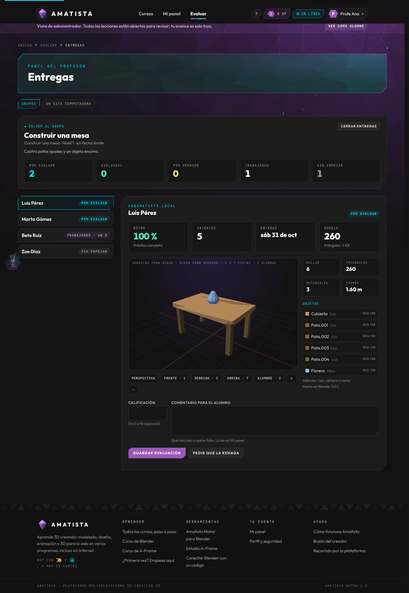
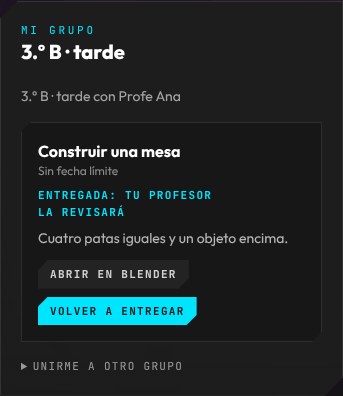

# 17 · Panel del profesor evaluador (31 oct 2026)

**Vigente.** El profesor no es alumno, administrador ni desarrollador: **evalúa**. Tiene su propio panel, «Evaluar» (`#/profesor`), y deja de ver Admin (solo los administradores lo ven). Servidor: `backend/api/evaluacion.py` y `sql/014_panel_del_profesor.sql`. Tablero: T-150 (hecho en el PR) y T-151 (aplicar 014 y desplegar).

## Qué hace el profesor

1. **Crea un grupo** («3.º B · tarde»). Cada grupo trae un código corto, como `AMA-7K2P`, sin letras que se confundan al dictarlo (sin 0/O ni 1/I/L).
2. Sus alumnos entran a **Mi panel › Mi grupo** y escriben el código (necesitan una cuenta con correo).
3. **Deja una práctica** de Blender publicada, con indicaciones y una fecha límite opcional.
4. En **Entregas** ve una fila por alumno: primero las que esperan evaluación, luego quien está trabajando (con su avance en vivo del motor), las evaluadas y quien no ha empezado.
5. Abre el **modelo** de cada alumno, lo gira y lo revisa pieza por pieza, y **evalúa**: calificación de 0 a 10, comentario, o «Pedir que la rehaga» (el alumno puede volver a entregar).

## El modelo: ligero, de paso por el servidor y guardado solo en la computadora del profesor

No se sube el `.blend` (pesa megas y Amatista no tiene almacenamiento para eso). El add-on describe la escena en el formato **`amatista.modelo/1`**:

- cada malla en triángulos, **con los modificadores aplicados** y en el espacio del mundo;
- los vértices cuantizados a enteros de 16 bits alrededor de un centro común (precisión de ~0.03 mm en una mesa de 2 m);
- el color base de cada material, las luces, cámaras y vacíos como puntos;
- todo el JSON comprimido con zlib y en base64.

Una práctica low poly pesa **de 1 a 40 KB** (la mesa de la prueba: 2 KB). Por encima de 60 000 triángulos, las mallas que sobran viajan como su caja y el visor lo avisa. El servidor revisa la forma (y que no sea una bomba de descompresión) y rechaza más de 1 MB.

El modelo **solo pasa** por Oracle:

| Momento | Dónde está el modelo |
|---|---|
| El alumno entrega | En `ENTREGAS.MODELO` |
| El profesor pulsa «Ver su modelo» | Se descarga, se arma y se guarda en IndexedDB (`amatista-profesor`) de **esa** computadora |
| Ya guardado | El navegador avisa al servidor y el servidor lo **borra** (`RECOGIDO_EN`) |
| Nadie lo recoge en 30 días | El servidor lo borra igual |

Si el navegador no puede guardar (modo privado), el modelo se muestra pero no se confirma, para que no se pierda. «En esta computadora» lista los modelos guardados y permite borrarlos. La calificación y el comentario sí quedan en el servidor (unos cientos de bytes).

Los tres lados hablan el mismo formato y tienen pruebas cruzadas: `addon/amatista_blender/modelo_ligero.py` (arma), `backend/contenido/modelo_ligero.py` (revisa) y `frontend/src/profesor/modelo.js` (vuelve a armar).

## El visor

`frontend/src/profesor/VisorModelo.jsx` dibuja en un `<canvas>` 2D, sin WebGL ni librerías (el chunk `Profesor-*.js` no entra al precache de los alumnos). Algoritmo del pintor con luz plana, el estilo low poly de Amatista. Se gira arrastrando, se acerca con la rueda o los botones, tiene las vistas del teclado numérico de Blender (1 frente, 3 derecha, 7 arriba), alambre con Z, y la lista de objetos con su material: al pasar el ratón se resalta la pieza y se puede ocultar.

## Lo que hace el alumno

- **Mi panel › Mi grupo**: unirse con el código, ver las prácticas con su estado (por entregar, entregada, evaluada con la nota, «tu profesor te pide rehacerla») y el comentario del profesor.
- **Entregar**: desde Mi panel (manda la orden `entregar` al Blender abierto) o desde Blender, menú **Amatista › Entregar a mi profesor**. Antes de entregar, el add-on sincroniza el intento: el progreso de la entrega lo pone el servidor con lo que midió el motor, no el add-on. Sin conexión, la entrega queda en la cola del add-on y se envía sola.

## API (`/api/evaluacion`)

Profesor (rol profesor o admin; cada quien ve solo sus grupos): `GET/POST /grupos`, `GET/PATCH /grupos/{id}`, `DELETE /grupos/{id}/alumnos/{alumno}`, `GET /practicas`, `POST /asignaciones`, `GET/PATCH /asignaciones/{id}`, `GET …/entregas/{alumno}/modelo`, `POST …/modelo/recibido`, `POST …/evaluar`.

Alumno: `POST /unirme`, `GET /mis-asignaciones`, `POST /mis-asignaciones/{id}/vista`, `DELETE /mis-grupos/{id}`, `POST /entregas`.

Sin 014 todo responde 503 y Mi grupo dice que se está preparando.

## Para desplegar (T-151)

1. Database Actions › SQL: `backend/sql/014_panel_del_profesor.sql` con «Ejecutar script» (F5). Va después de 013. `diagnostico_oracle.py` debe ver 28 tablas.
2. Actualizar el backend y reiniciar `amatista-backend`; publicar la PWA.
3. Reinstalar el add-on (trae «Entregar a mi profesor»).
4. Dar el rol profesor: `python herramientas/crear_admin.py correo@escuela.mx --rol profesor`.
