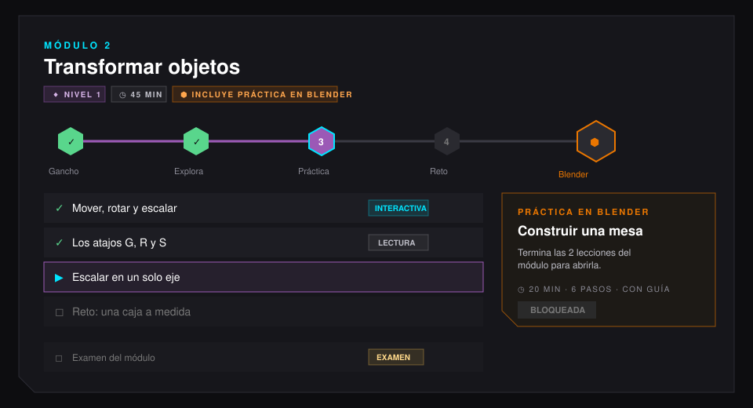

# Plataforma Amatista (v3.5.1 · 9 de octubre de 2026)

Cómo está organizada la plataforma para alumnos, profesores y administradores en el estado actual de integración con Blender. Lo técnico del motor y del add-on está en [`docs/motor/`](../motor/README.md).

> «La plataforma la siento muy dispersa… esa parte que le agregamos como una pestaña a Blender no está bien, sino hacerlo en una integración en los módulos: que cada módulo cuente con una práctica de Blender en la cual primero realices el módulo y ya luego realices la práctica en Blender.» (Maximiliano, 4 oct 2026)

| Documento | Qué explica |
|---|---|
| [01 · Mapa de la plataforma](01_mapa_de_la_plataforma.md) | Qué ve cada persona (alumno, profesor, administrador) y dónde está cada cosa. |
| [02 · Módulos con práctica en Blender](02_modulos_y_practica.md) | La regla «primero el módulo, luego la práctica», cómo se ve y cómo se arma. |
| [03 · Etiquetas y gráficos](03_etiquetas_y_graficos.md) | El sistema de etiquetas low poly, la ruta del módulo y la estación de Blender. |
| [04 · Herramientas de enseñanza](04_herramientas_de_ensenanza.md) | Los 20 bloques con los que se arma una lección, con sus campos y cuándo usar cada uno (3 nuevos). |
| [05 · Panel de administración](05_panel_de_administracion.md) | Cómo se organiza el panel y el flujo para subir un módulo con su práctica. |
| [06 · Módulo 3: modelado con precisión](06_modulo_3_modelado_precision.md) | Histórico: el módulo de precisión de la v2 como ejemplo completo (hoy archivado en `frontend/src/data/modulos/archivo/`). |
| [07 · Herramientas gráficas](07_herramientas_graficas.md) | Qué gráficos tenemos, qué se agregó en la v3.2 y qué conviene desarrollar (investigación). |
| [08 · Auditoría educativa (9 oct)](08_auditoria_educativa_2026-10-09.md) | Qué está bien, qué está fallando y qué se corrige primero en documentación y producto. |
| [09 · Guía, vista de alumno y auditoría (10 oct)](09_guia_vista_y_auditoria.md) | La guía de primeros pasos para alumnos nuevos, las instrucciones en cada lección y curso, y para el equipo: vista de alumno o administrador, saltar a cualquier lección y la auditoría. |
| [10 · Primeros pasos y recursos gráficos (11 oct)](10_primeros_pasos_y_recursos.md) | Los siete recursos gráficos nuevos intercalados en las lecciones y el CSS v3.7. Histórico: el curso «Primeros pasos con Amatista» y el recorrido del add-on 5.1 (retirados en el doc 11). |
| [11 · Recorrido guiado, página Blender y «Conoce Amatista Motor» (11 oct)](11_recorrido_y_fusion.md) | **Vigente** salvo la barra (ver 12): el recorrido de 10 paradas por las páginas reales; la tarjeta de cómo se unen la plataforma y Blender; las tres prácticas del add-on 5.2; Ayuda y Mi panel. |
| [14 · Refinamiento y dinámicas v4.3 (30 oct)](14_refinamiento_y_dinamicas.md) | **Vigente.** «Abrir en Blender» abre Blender (`amatista://`); Amatista dentro de Blender (add-on 5.4); botones Facetas 4.1 y tarjetas para elegir nivel; Entrena tus teclas, Ajusta el valor y Encuentra el error. |
| [13 · Camino guiado, gráficos y Motor Web (23 oct)](13_camino_graficos_y_motor_web.md) | **Vigente.** Cursos como camino guiado (sin buscador); simulador de la vista, elige la figura, línea de tiempo y «En la industria»; Motor Web sobre A-Frame; A-Frame Inicial e Interactivo; add-on 5.3. |
| [12 · Multiplataforma y accesible (21 oct)](12_multiplataforma_y_accesible.md) | **Reemplazado en parte por 13** (Explorar salió). Inicio · Explorar · Mi panel; Explorar con buscador y filtros; el Estudio A-Frame; el curso de A-Frame con 5 módulos; accesibilidad y cómo se suma un programa nuevo (Maya, 3ds Max). |
| [Diseño «Facetas» (11 oct)](../diseno/2026-10-11_sistema_facetas.md) | **Vigente.** La anatomía común de todas las páginas (migas, encabezado facetado, secciones y pie global), los cuatro anchos y el CSS v4.0 del tema low poly. |

## Resumen de cambios (v3.2 · curso unificado)

- **Una tarjeta por curso.** «Blender» es una sola tarjeta que se ramifica en Principiante, Principiante-Intermedio, Intermedio y Avanzado; la página del curso (`#/curso/blender`) muestra el árbol de niveles, «Tu Blender» (equipos conectados y prácticas registradas) y el mapa de cada nivel. A-Frame tiene el mismo trato. Logos SVG de Blender y A-Frame.
- **Teoría y Blender intercalados** ([02](02_modulos_y_practica.md)): exploración corta en Blender y práctica de cierre en cada módulo, todo registrado con el add-on conectado.
- **Cada módulo con su temática** y un **jefe final** en el examen que pierde vida con cada acierto.
- **Medallas progresivas** (5 logros × bronce, plata y oro) que se revelan al avanzar, y **racha animada**.
- **Curso Intermedio publicado**; Avanzado bloqueado hasta tener su teoría ([ruta de aprendizaje](../cursos/03_ruta_de_aprendizaje_blender.md)).
- **Más claro y más ligero:** el ejercicio de emparejar con más contraste, animaciones CSS nuevas y un modo ligero para equipos modestos ([07](07_herramientas_graficas.md)). Mismo diseño y misma paleta.
- **Sin cambios en Oracle.** El curso Intermedio se crea solo al importar (`asegurar_cursos_base`).

## Resumen de cambios (11 de octubre · auditoría y orden)

- **Tres lugares**: la barra queda en **Cursos · Blender · Mi panel** (· Admin). La página Blender vuelve a la barra: es la mitad de Amatista y escondida en el menú de la cuenta no se encontraba.
- **Recorrido guiado** en lugar del curso de introducción: 10 paradas por las páginas reales, no da XP.
- **Cómo se unen la plataforma y Blender**: una tarjeta con el proceso paso a paso, arriba de la página Blender y en Ayuda.
- **Conoce Amatista Motor** (add-on 5.2): tres prácticas que explican todo el add-on, empezadas y vistas en vivo desde la página Blender.
- **Ayuda** sin candados y **Mi panel** con una tarjeta por curso. Detalle en [11](11_recorrido_y_fusion.md) y el informe en `docs/auditoria/2026-10-11_auditoria_completa.md`.

## Resumen de cambios (9 de octubre · la plataforma maneja Blender y el ejemplo manda)

- **Abrir en Blender** desde la lección: la práctica se abre en el Blender del alumno, en su propia escena, y la lección dice «Tu Blender está en esta práctica (N %)» (Motor 3.4).
- **Ahora en Blender**: la lección muestra el paso y lo que dice el instructor, con los botones Comprobar, Pista, Hazlo conmigo, Guardar, Empezar de nuevo y Ver el ejemplo (Motor 3.5).
- **El ejemplo resuelto** de cada práctica en la lección (pasos, qué compara Amatista y el código) y la lista «Comparado con el ejemplo · N de M» (Motor 3.5).
- **Mi Blender** decide cómo se ve Blender: modo enfocado, acompañamiento, tarjeta en la vista 3D y avisos de herramientas.
- **Oracle 010 y 011** guardan el enlace en vivo y lo que muestra el instructor. Sin ellos la práctica funciona como antes. Detalle en [02](02_modulos_y_practica.md#dentro-de-la-práctica).

## Estado vigente (9 de octubre)

- La plataforma y Blender se trabajan como un flujo único de aprendizaje: la plataforma guía el recorrido y Blender ejecuta práctica con acompañamiento.
- El motor ya incluye etapas 3.4, 3.5 y 3.5.1 (reconocimiento de figura, instructor por checklist y revisión contra ejemplo).
- El panel del alumno se centra en estado real de avance y práctica, sin promesas visuales de funciones no cerradas.
- El roadmap histórico (piloto y fases previas) se mantiene en bitácora y cronología; la operación diaria vive en `KANBAN.md` y `PROYECTO.md`.

## Resumen de cambios (v3.1)

- **Estructura fija, sin pestañas sueltas.** La barra superior queda en Cursos, Mi panel y Admin (para profesores y administradores); salen Blender y el Laboratorio técnico (que era una página de pruebas y pasa a ser un diagnóstico solo para el equipo). La conexión con Blender pasa a **Mi Blender** (menú de la cuenta) y, sobre todo, a la propia práctica.
- **Cada módulo cierra con su práctica en Blender.** En el mapa del curso, la práctica es una estación al final de la ruta del módulo; se abre al terminar las lecciones. Solo el examen puede ir después.
- **Preparar Blender dentro de la práctica.** Descargar, abrir Blender y escribir el código se hace en la misma tarjeta de la lección, en tres pasos.
- **Etiquetas comunes.** El mismo idioma visual (tipo de lección, práctica, guía, nivel, duración, estado) en el mapa, la lección, el panel del alumno y el panel de administración.
- **Tres herramientas nuevas:** Paso a paso, Atajos de teclado (con modo «Pruébate») y Comparar.
- **Panel de administración por tareas:** Enseñanza (Módulos, Prácticas de Blender, Herramientas), Personas y Sistema, con una página de Herramientas que muestra cada bloque como lo ve el alumno.
- **Sin cambios en Oracle.** Todo vive en el JSON de las lecciones y en el frontend; la única regla nueva (orden de la práctica) la valida el servidor.

## Resumen de cambios (21 de octubre · multiplataforma)

- **Blender deja de ser el centro**: Amatista enseña 3D (modelado, diseño, render, animación, interacción y XR) en varios programas. Hoy Blender y A-Frame; Maya y 3ds Max, próximamente.
- **Barra Inicio · Explorar · Mi panel** (· Admin) y **Explorar** con todo el contenido en una sola página, buscador y filtros por programa y disciplina.
- **A-Frame con 5 módulos** y el **Estudio A-Frame**. Detalle en [12](12_multiplataforma_y_accesible.md).

## Resumen de cambios (23 de octubre · camino guiado)

- **Explorar sale**: la portada «Cursos» es un camino guiado por programa, con el paso siguiente marcado. Barra **Cursos · Mi panel**.
- **Lecciones más gráficas** y lecturas opcionales «En la industria»; **Motor Web de Amatista** sobre A-Frame; **A-Frame Inicial e Interactivo**; **add-on 5.3**. Detalle en [13](13_camino_graficos_y_motor_web.md).

## Resumen de cambios (30 de octubre · refinamiento)

- **«Abrir en Blender» abre Blender** aunque esté cerrado (enlace `amatista://`) y avisa si no se abrió.
- **Amatista dentro de Blender** (add-on 5.4): menú arriba, botón en la vista 3D, barra de estado y espacio de trabajo propio.
- **Botones que se ven como botones** (Facetas 4.1), tarjetas grandes para elegir nivel y navegación más legible.
- **Tres dinámicas nuevas**: Entrena tus teclas, Ajusta el valor y Encuentra el error. Detalle en [14](14_refinamiento_y_dinamicas.md).
